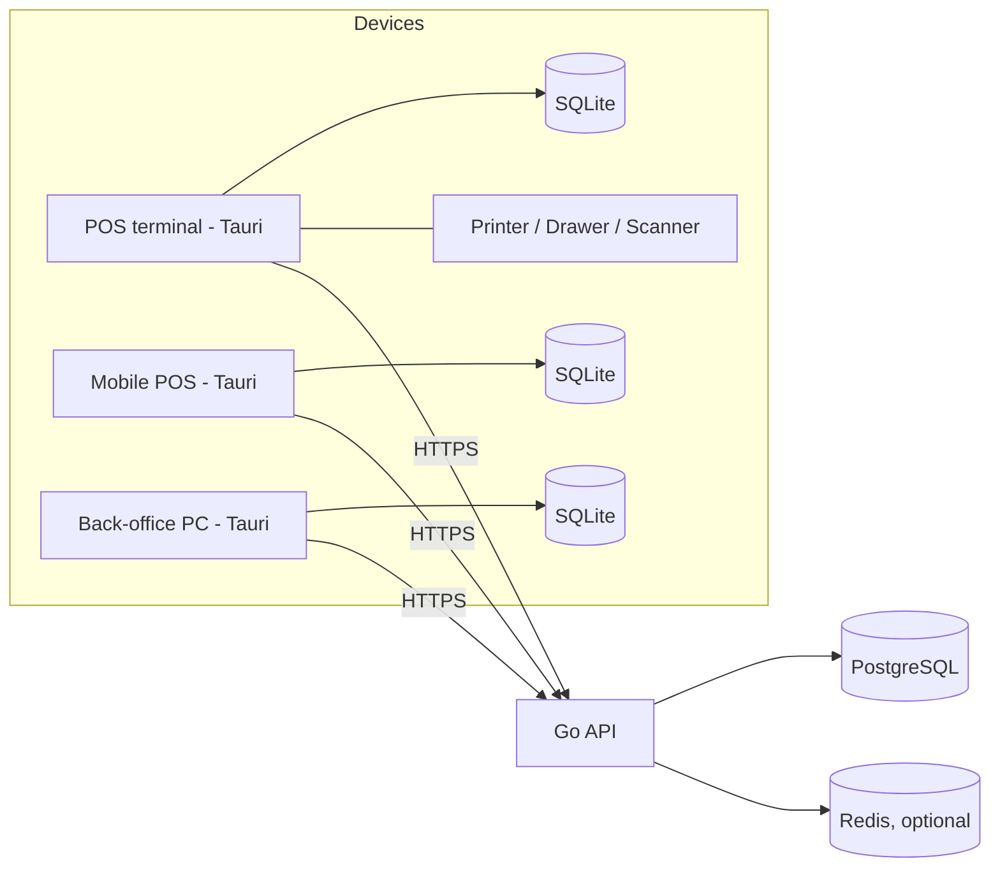

# Architecture — [POS Name]

> 🚨 **THIS IS A PROPOSAL, NOT A DESCRIPTION OF THE SYSTEM.**
> It was written as a target architecture. Most of it is **not built**.
> The real system is documented in [`README/02-design/ARCHITECTURE.md`](README/02-design/ARCHITECTURE.md).
> For a per-claim reconciliation of this file against the code, see
> [`README/05-reference/SUPPORTING-DOCS.md`](README/05-reference/SUPPORTING-DOCS.md).
>
> Already true: offline-first goal, server re-validation, modular monolith, money as
> decimal, business rules in the domain layer.
> Not built: SQLite/SQLCipher, outbox sync, Clean Architecture layout, sqlc, auth/RBAC,
> rate limiting, OpenAPI contracts, Tauri mobile, K8s deployment, receipt numbering.
> Unverified: every latency and throughput target in this document.

> **Status**: Draft proposal
> **Last Updated**: 2026-09-28

---

## 1. System Overview

[POS Name] is an **offline-first Point-of-Sale system** with:

- **Clients**: Tauri 2 app (React + TypeScript + Vite webview, Rust core) running on Windows/macOS/Linux (POS terminal, back-office PC) and Android/iOS (mobile POS).
- **Local storage**: encrypted SQLite on every device. Selling never depends on the network.
- **Backend**: Go modular monolith on PostgreSQL. It is the **source of truth** for catalog, pricing, inventory, orders, and reporting, and it re-validates everything a client submits.
- **Sync**: transactional outbox on the client, idempotent ingest on the server.

### Goals

- Sell, pay, and print a receipt with **no internet** (target: checkout < 300 ms locally).
- Never lose or duplicate an order, even across crashes, retries, and network drops.
- One React codebase for POS, PC, and mobile, with device-specific layouts only.
- Hardware access (printer, cash drawer, scanner) isolated behind ports.

### Non-Goals (v1)

- Real-time multi-device inventory locking across branches.
- Microservices (start as a modular monolith).
- Custom payment processing; use PromptPay QR / external EDC integrations.

---

## 2. Architecture Style

**Clean Architecture (ports & adapters), applied fully only to core domains** (sales, payment, inventory, shift). Simple CRUD modules (e.g., store settings) may use a plain layered approach.

**Dependency rule:** outer layers depend on inner layers, never the reverse. `domain` must not import React, Tauri, SQL, or HTTP.

```
┌──────────────────────── Client (Tauri 2) ────────────────────────┐
│ presentation  (React components, hooks, Zustand UI state)        │
│      ↓                                                           │
│ application   (use cases + ports: OrderRepo, PrinterPort, ...)   │
│      ↓                                                           │
│ domain        (Cart, Order, Money, DiscountPolicy — pure TS)     │
│                                                                  │
│ infrastructure (adapters implementing ports)                     │
│   HttpApiClient | TauriSqliteRepo | TauriPrinter | SyncEngine    │
│      ↓ invoke()                                                  │
│ Rust core: SQLite/SQLCipher, ESC/POS, drawer, BT/USB, keychain,  │
│            background sync worker                                │
└───────────────────────────┬──────────────────────────────────────┘
                            │ HTTPS (OpenAPI) + sync endpoints
┌───────────────────────────▼──────────────────────────────────────┐
│ Go: adapter/http → usecase → domain                              │
│ adapter/postgres (sqlc) | outbox publisher | auth | audit        │
└──────────────────────────────────────────────────────────────────┘
```

**Key rule:** business logic lives in **one place per side**: TS `domain` on the client (fast, offline) and Go `domain` on the server (authoritative). Rust does **not** contain business rules; it is a native adapter only.

---

## 3. Major Components

### 3.1 Client

| Component | Responsibility | Key Files |
|-----------|----------------|-----------|
| **App Shell** | Layout, theme, error boundary, DI container | `src/App.tsx`, `src/main.tsx`, `src/shared/di/` |
| **Router** | Page routing, device-specific layouts (POS / mobile / back-office) | `src/routes/` |
| **Sales feature** | Cart, checkout, refund, hold/recall | `src/features/sales/{domain,application,infrastructure,presentation}/` |
| **Catalog feature** | Products, prices, barcodes (read-mostly, synced down) | `src/features/catalog/` |
| **Payments feature** | Cash, PromptPay QR, card/EDC | `src/features/payments/` |
| **Shift feature** | Open/close shift, cash count, X/Z report | `src/features/shift/` |
| **Inventory feature** | Stock view, adjustments | `src/features/inventory/` |
| **Platform ports** | `PrinterPort`, `CashDrawerPort`, `ScannerPort` + Tauri adapters | `src/platform/` |
| **Sync Engine** | Outbox drain, pull deltas, conflict handling | `src/features/sync/` (orchestration) + `src-tauri/src/sync/` (worker) |
| **UI Primitives** | Buttons, inputs, dialogs | `src/components/ui/` |
| **Tauri Bridge** | Commands: DB, printer, drawer, secure storage | `src-tauri/src/commands/` |

### 3.2 Backend (Go)

| Component | Responsibility | Key Paths |
|-----------|----------------|-----------|
| **order** | Order ingest, validation, numbering, refund | `internal/order/` |
| **catalog** | Products, prices, promotions | `internal/catalog/` |
| **inventory** | Stock ledger, adjustments | `internal/inventory/` |
| **payment** | Payment records, reconciliation | `internal/payment/` |
| **sync** | Push/pull endpoints, cursors, idempotency store | `internal/sync/` |
| **platform** | Config, logger, DB, auth, outbox, audit | `internal/platform/` |
| **Composition root** | Wiring / DI | `cmd/api/main.go` |

Each module: `domain/` → `usecase/` (with repository interfaces) → `adapter/{http,postgres}/`. Transaction boundaries live in the use case.

### 3.3 Monorepo layout

> **RESOLVED — blueprint D1 (2026-10-02).** The previous layout in this file
> (`/apps/pos-client`, `/services/api`) conflicted with the operational SOP in
> `SKILL.md` (`/apps/pos-desktop`, `/services/api-backend`). The SOP naming is
> now authoritative. This section is the single source of truth for directory
> layout; `SKILL.md` §4 refers here rather than restating paths.

```
wal-asri-pos/
├── package.json                       # Root workspace manifest (Bun) — non-runtime
├── bun.lock                           # generated by first `bun install`
├── tsconfig.base.json                 # shared TS compiler options
│
├── contracts/                         # ⛔ NOT a Bun workspace (no package.json)
│   └── openapi.yaml                   # OpenAPI 3.0 — source of truth for all types
│
├── packages/
│   └── api-types/                     # ✅ Bun workspace · @wasri/api-types
│       └── src/index.ts               # GENERATED by openapi-typescript — never hand-edited
│
├── apps/
│   ├── pos-desktop/                   # ✅ Bun workspace · POS terminal
│   │   ├── src/                       #   presentation + application + platform
│   │   │   ├── features/{sales,catalog,payments,shift,inventory,sync}/
│   │   │   │   └── domain/            #   PURE TypeScript — no React/Tauri/SQL
│   │   │   ├── routes/                #   device-specific layouts
│   │   │   ├── platform/              #   PrinterPort, CashDrawerPort, ScannerPort
│   │   │   └── components/ui/         #   design-system primitives
│   │   ├── src-tauri/                 #   Rust: hardware adapter ONLY, no business rules
│   │   │   ├── src/commands/          #   Tauri command registration
│   │   │   ├── src/sync/              #   background outbox-drain worker
│   │   │   └── migrations/            #   local SQLite (SQLCipher)
│   │   ├── e2e/                       #   Playwright specs
│   │   └── src/test/                  #   unit tests
│   │
│   ├── pos-mobile/                    # ✅ Bun workspace · Expo + TanStack Query
│   └── admin-web/                     # ✅ Bun workspace · Next.js (App Router)
│
├── services/
│   └── api-backend/                   # ⛔ NOT a Bun workspace (Go) · 🔴 GRIT-BLOCKED
│       ├── cmd/api/main.go            #   composition root
│       ├── internal/                  #   domain → usecase → adapter/{http,postgres}
│       │   ├── catalog/ order/ inventory/ payment/ shift/ sync/ platform/
│       └── db/
│           ├── queries/*.sql          #   sqlc sources  ⏸️ HELD
│           └── migrations/            #   goose        ⏸️ HELD
│
├── dev/                               # infra ops (not a workspace)
│   ├── DEV-SETUP.md
│   └── wasri                          # namespaced `sudo nerdctl -n walasri` wrapper
├── docker-compose.yml                 # postgres :5433, redis :6380
└── docs/02-design/DOMAIN.md           # 38 entities
```

**Workspace membership.** Only `apps/*` and `packages/*` are Bun workspaces.
`services/api-backend` is Go (no `package.json`); `contracts/` is data with no
runtime (no `package.json`). Listing either in `workspaces` would make
`bun install` look for manifests that do not exist.

### 3.4 Dependency / boundary map

```
                      contracts/openapi.yaml
                              │  (hand-edited — SOP §4 Step 1)
                              ▼
                     packages/api-types      ── generated, never hand-edited
                              │
        ┌─────────────────────┼─────────────────────┐
        ▼                     ▼                     ▼
  apps/pos-desktop      apps/pos-mobile      apps/admin-web
        │                     │                     │
   (offline-first)      (mobile orders)     (back-office)
        │
   src-tauri/ (Rust)
   • ESC/POS printer, cash drawer, scanner   ← hardware adapter
   • SQLCipher key, native SQLite worker     ← §2.3: NO business rules
   • sync worker: drain outbox → POST /sync/push
        │  HTTPS + Idempotency-Key
        ▼
  services/api-backend  🔴 GRIT-BLOCKED
        │  internal/{catalog,order,inventory,payment,shift,sync,platform}
        │  domain → usecase → adapter/{http,postgres}
        ├──────► PostgreSQL  (localhost:5433, containerd ns `walasri`)
        └──────► Redis       (localhost:6380, cache / rate-limit / idempotency)
```

**Enforced boundaries (SKILL.md §2.3):**

| Boundary | Rule |
|---|---|
| Client `features/*/domain/` | Pure TypeScript. **No** React, Tauri, or SQL imports. |
| Rust `src-tauri/src/` | Native hardware adapter only. **No** business rules. |
| Go `internal/*/domain/` | Authoritative; re-validates every client payload on ingest. |
| `packages/api-types` | Downstream of `contracts/` only — no reverse dependency. |
| App → App | Forbidden. Apps share `packages/api-types` and nothing else. |

**Why the POS terminal does not depend on the server.** The system is
offline-first (SKILL.md §1, §2.2): checkout completes, records the sale, and
prints with no network. A full vertical slice — add item → pay → save to local
SQLite → print receipt — is therefore deliverable **while `grit` is blocked**.
Only the sync leg (`/sync/push`, `/sync/pull`) depends on `services/api-backend`.

> ⚠️ `internal/*` above is a **proposal**, not a description. `grit generate
> resource` owns the real module layout once unblocked. Do not pre-create it.

---

## 4. Data Flow

### Checkout (Write Path, offline-safe)

```mermaid
sequenceDiagram
    participant UI as React (presentation)
    participant UC as Checkout use case
    participant Repo as Tauri SQLite adapter
    participant DB as Local SQLite
    participant Print as PrinterPort

    UI->>UC: checkout(cart, payments)
    UC->>UC: domain validates (totals, discounts)
    UC->>Repo: saveOrder(order, idempotencyKey)
    Repo->>DB: BEGIN; INSERT order; INSERT outbox; COMMIT
    DB-->>Repo: ok
    Repo-->>UC: saved
    UC->>Print: printReceipt(order)
    UC-->>UI: success (no network needed)
```

The order row and its outbox row are written in **one local transaction**. That is what guarantees "no order without a sync record".

### Sync Up (Outbox → Go)

```mermaid
sequenceDiagram
    participant W as Rust sync worker
    participant DB as Local SQLite (outbox)
    participant API as Go /sync/push
    participant PG as Postgres

    W->>DB: SELECT pending outbox (batch)
    W->>API: POST batch + Idempotency-Key per item
    API->>PG: BEGIN; check idempotency; validate; INSERT; COMMIT
    API-->>W: per-item result (accepted / rejected / duplicate)
    W->>DB: mark done / failed (with reason)
```

### Sync Down (Read Path)

Catalog, prices, and settings are pulled by **cursor** (`GET /sync/pull?since=<cursor>`), applied to local SQLite, and the UI reads only from local SQLite (TanStack Query wraps the local repo). The UI never blocks on the network for reads.

---

## 5. Authentication & Authorization

| Aspect | Decision |
|--------|----------|
| **User auth** | Staff login with PIN (fast, on-device) + server-issued JWT/refresh token when online. Offline PIN verified against locally stored salted hash. |
| **Device auth** | Each terminal registers once and gets a device credential stored in the OS keychain (Rust). Server can revoke a device. |
| **Authorization** | RBAC: `cashier`, `supervisor`, `manager`, `admin`. Sensitive actions (void, refund, discount override, price change, drawer open without sale) require supervisor PIN and are audit-logged. |
| **Multi-user / multi-branch** | Supported. Every record carries `branch_id`, `device_id`, `staff_id`. |
| **Server enforcement** | Go re-checks permissions and data on ingest; the client is never trusted. |

---

## 6. External Services

| Service | Purpose | Required? | Notes |
|---------|---------|-----------|-------|
| PromptPay QR (Thai QR standard) | Generate payment QR | Optional | QR payload generated locally; confirmation flow is a `TODO` (manual confirm vs. bank/gateway webhook) |
| Card / EDC terminal | Card payments | Optional | Integrated via vendor SDK/serial/LAN behind a `PaymentGateway` port |
| Receipt printer | ESC/POS printing | Required | USB / LAN / Bluetooth; see Section 7 `TODO` |
| e-Tax / tax invoice provider | Tax invoices | `TODO` | Decide before finalizing document numbering |
| Object storage / backup | DB backups, exports | Optional | |

---

## 7. Background Jobs

| Job | Where | Trigger | Notes |
|-----|-------|---------|-------|
| **Outbox drain** | Rust worker | Interval + connectivity change + after checkout | Exponential backoff with jitter; batch size capped |
| **Catalog/price pull** | Rust worker | Interval + app start | Cursor-based, resumable |
| **Retry of failed items** | Rust worker | Backoff | Permanent failures move to a "needs attention" queue visible in UI |
| **Local DB maintenance** | Rust | Daily | Prune synced outbox rows after retention window, `VACUUM` |
| **Server outbox/publisher** | Go | Poll / notify | For downstream events (reporting, notifications) |
| **Reconciliation** | Go | Nightly | Compare device totals vs. server totals per shift |

```
┌────────────┐   ┌─────────────┐   ┌──────────────┐   ┌─────────────┐
│ Local write│──▶│ Outbox row  │──▶│ Sync worker  │──▶│ Go ingest   │
└────────────┘   └─────────────┘   └──────────────┘   └─────────────┘
```

---

## 8. Caching Strategy

| Layer | Strategy | TTL / Invalidation |
|-------|----------|--------------------|
| **Local SQLite** | Authoritative on-device store; replicated subset of server data | Updated by pull cursor |
| **TanStack Query** | In-memory cache over local repo queries | Invalidated on local write |
| **Zustand** | UI state only (current cart, selected tab), never a data cache | N/A |
| **Server (Redis, optional)** | Catalog snapshots, rate limiting, idempotency fast path | Short TTL; Postgres remains the truth |

---

## 9. Storage

- **Client**: SQLite in the Tauri app data directory, encrypted with **SQLCipher**; key held in OS keychain/keystore.
- **Server**: PostgreSQL via `sqlc`; migrations with `goose`/`atlas`.
- **Schema**: See `DATA_MODEL.md` (must include `outbox`, `idempotency_keys`, `sync_cursor`, `audit_log`).
- **IDs**: client-generated **UUIDv7** so orders can be created offline and remain sortable.
- **Money**: integer minor units (satang) or decimal. **Never float.**
  - TS: integer satang wrapped in a `Money` value object.
  - Go: `int64` or `shopspring/decimal`.
  - Rust: `rust_decimal` (or plain `i64`). The `rug` crate (GMP) is not recommended: it adds a C dependency that is hard to cross-compile for iOS/Android, and POS arithmetic does not need arbitrary precision.
- **Document numbering**: receipt/invoice numbers must be gap-free per branch/device series. Assign a local provisional number offline and a device-scoped series (e.g., `DEV01-000123`); avoid a global counter that requires network. `TODO`: confirm tax-invoice numbering rules.
- **Conflict rules**:
  - Orders: append-only, never edited, so no conflict. Corrections are refund/void documents.
  - Inventory: stock is a **ledger of movements**, not an overwritten number; server computes the balance.
  - Catalog/prices: server wins (last-write-wins by version).
- **Backup**: server backups (Postgres PITR) + optional encrypted JSON export of local data.

---

## 10. Deployment Architecture



| Artifact | Description |
|----------|-------------|
| **Desktop build** | `tauri build` → `.msi`, `.dmg`, `.deb`/`.AppImage` |
| **Mobile build** | `tauri android build`, `tauri ios build` (Tauri 2 mobile; hardware plugins may need custom Rust/Kotlin/Swift) |
| **Dev** | `tauri dev` (hot reload + debugger) |
| **Backend** | Container image, one Go binary + Postgres (+ Redis if needed) |
| **Updater** | Tauri updater (desktop); app stores for mobile. Enforce a **minimum client version** at the API so old clients cannot push incompatible data |
| **Contracts** | OpenAPI spec in `/contracts`; CI generates Go server stubs and TS types and fails on drift |

---

## 11. Important Architectural Decisions

| ADR ID | Decision | Rationale |
|--------|----------|-----------|
| ADR-001 | Offline-first with local SQLite on every client | POS must sell without internet |
| ADR-002 | Transactional outbox + idempotency keys for sync | Exactly-once effect over at-least-once delivery |
| ADR-003 | Go server is the source of truth and re-validates all input | Clients (and their local logic) are untrusted |
| ADR-004 | Business logic in TS domain (client) and Go domain (server); Rust is adapter-only | Avoid triple duplication of rules |
| ADR-005 | Clean Architecture for core domains only; plain layers for CRUD | Avoid ceremony without benefit |
| ADR-006 | Modular monolith (Go), no microservices in v1 | Simpler ops, boundaries preserved for later split |
| ADR-007 | Money as integer minor units / decimal; no `rug`/float | Correctness and mobile cross-compile |
| ADR-008 | OpenAPI-first contracts with generated types | Type-safe boundary across Go and TS |
| ADR-009 | Append-only orders; inventory as movement ledger | Removes most sync conflicts |

(See `04-ai/DECISIONS.md` for full records.)

---

## 12. Known Trade-offs

| Trade-off | Impact (Pro) | Impact (Con) |
|-----------|--------------|--------------|
| Offline-first with local DB | Sells during outages, fast UI | Sync complexity, eventual consistency, stock can oversell briefly |
| Duplicate domain logic (TS + Go) | Offline validation + authoritative server | Rules can drift; mitigate with shared test vectors/golden cases |
| Tauri for mobile | One codebase, small binaries | Mobile is newer; Bluetooth/USB printer support may need custom plugins |
| Modular monolith | Simple deploy and debugging | Must enforce module boundaries by discipline |
| Device-scoped document numbers | Works offline | Numbers are not globally sequential across devices |
| SQLCipher | Data encrypted at rest | Extra build complexity, esp. on mobile |

---

## 13. Open Questions (`TODO` — fill before finalizing)

| # | Question | Impacts |
|---|----------|---------|
| 1 | Number of branches and terminals per branch? Multiple terminals in one store need a local hub or peer sync? | Sync topology, Section 4/7 |
| 2 | Printer connection type per platform (USB / LAN / Bluetooth)? | Rust adapters, mobile plugins |
| 3 | Payment methods (PromptPay confirmation method, EDC vendor)? | Payment port design |
| 4 | Tax invoice / e-Tax required? | Numbering, audit log, Section 9 |
| 5 | Expected order volume per day per device? | Batch sizes, DB tuning |
| 6 | Data retention / PDPA requirements? | Local pruning, backups, deletion |

---

## 14. Suggested Build Order

1. Define OpenAPI contracts (`orders`, `sync`, `catalog`) and generate types.
2. Design `outbox`, `idempotency_keys`, `sync_cursor` schemas (SQLite + Postgres).
3. Build one **vertical slice**: add item → pay → save to SQLite → print → sync to Go.
4. Test offline early: cut the network mid-sale, restart the app, retry duplicates.
5. Test a real Bluetooth printer on Android before committing to the mobile plan.
6. Expand to shift, inventory, refunds, and reporting.