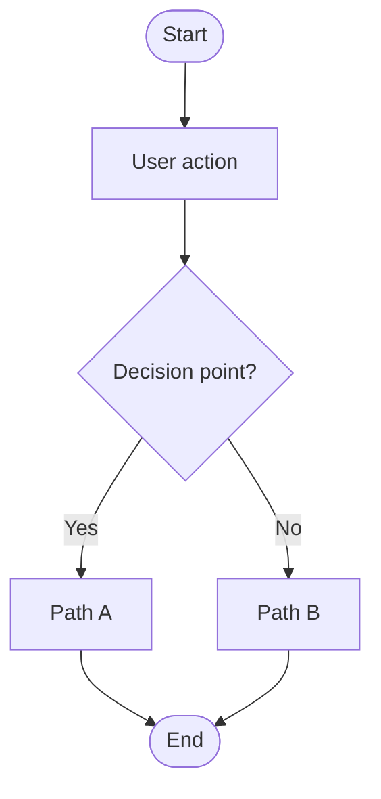

# Product Requirements Document — [Product Name]

> **Status**: Draft
> **Product Owner**: [Name]
> **Last Updated**: [Date]

---

## 1. Product Overview

| Field | Value |
|-------|-------|
| **Product Name** | [Product Name] |
| **Tagline** | [One-line description of the product] |
| **Mission** | [Why this product exists] |
| **Target Platforms** | [e.g., macOS, Windows, Linux (Tauri desktop app)] |
| **Deployment Model** | Local-first desktop application (SQLite on device) |
| **Tech Stack** | React + TypeScript + Vite, Tauri (Rust), SQLite |

### Summary

[Describe the product in 2–3 paragraphs. What problem does it solve? For whom? Why now?]

---

## 2. Target Audience

| Segment | Persona | Needs |
|---------|---------|-------|
| [e.g., Primary] | [Persona name, role] | [Key needs] |
| [e.g., Secondary] | [Persona name, role] | [Key needs] |

---

## 3. Feature Requirements

### Priority Legend

| P0 | P1 | P2 |
|-----|-----|-----|
| Must ship in MVP | Nice to have, planned | Future consideration |

### Feature Table

| ID | Name | Priority | Description | User Story |
|----|------|----------|-------------|------------|
| F-001 | [Feature Name] | P0 | [Short description] | As a [user], I want to [action] so that [benefit]. |
| F-002 | [Feature Name] | P0 | [Short description] | As a [user], I want to [action] so that [benefit]. |
| F-003 | [Feature Name] | P1 | [Short description] | As a [user], I want to [action] so that [benefit]. |

### Non-Functional Requirements

| ID | Category | Requirement | Rationale |
|----|----------|-------------|-----------|
| N-001 | Performance | [e.g., App starts in <2s] | [Why] |
| N-002 | Reliability | [e.g., 99% offline availability] | [Why] |
| N-003 | Security | [e.g., Data encrypted at rest] | [Why] |
| N-004 | Portability | [e.g., Runs on macOS 12+, Windows 11, Ubuntu 22.04+] | [Why] |

---

## 4. User Flows

### Flow 1: [Flow Name]

### Flow 2: [Flow Name]

[Add as many flows as needed.]

---

## 5. Success Metrics

| Metric | Definition | Target | Measurement |
|--------|-----------|--------|-------------|
| [e.g., DAU] | [Daily active users] | [≥1000] | [Analytics / manual] |
| [e.g., Task completion rate] | [Tasks created that are completed] | [≥80%] | [App analytics] |
| [e.g., Crash rate] | [Rate of unhandled exceptions] | [<0.1%] | [Error reporting] |

---

## 6. Development History

| Version | Date | Milestone | Notes |
|---------|------|-----------|-------|
| 0.1.0 | [Date] | Initial scaffold | Template created |
| [Next] | [Date] | [Milestone] | [Notes] |

---

## 7. Roadmap

### Phase 1 — MVP (P0)

- [ ] [Feature F-001 name]
- [ ] [Feature F-002 name]

### Phase 2 — Growth (P0 + P1)

- [ ] [Feature F-003 name]
- [ ] [Feature ...]

### Phase 3 — Expansion (P2)

- [ ] [Future feature]

---

## 8. Constraints

- [e.g., Must run fully offline after first launch]
- [e.g., Storage limited to SQLite; no network calls in core flows]
- [e.g., Must comply with [regulation]]
- [e.g., Must support [locale]]

---

## 9. Open Questions

| ID | Question | Owner | Status |
|----|----------|-------|--------|
| Q-001 | [Question] | [Name] | [Open / Answered] |
| Q-002 | [Question] | [Name] | [Open / Answered] |
