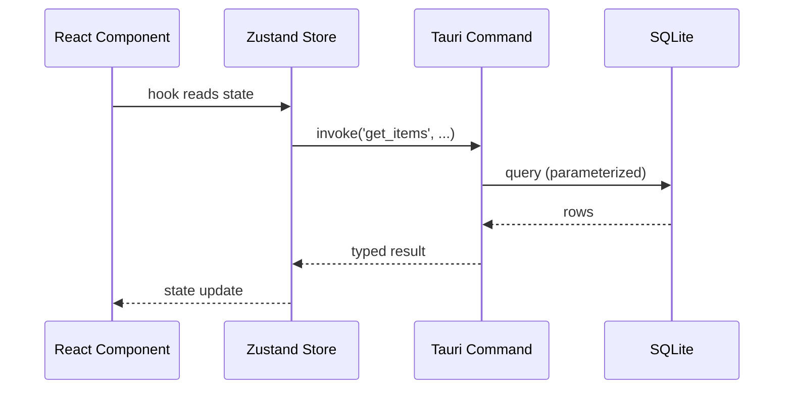
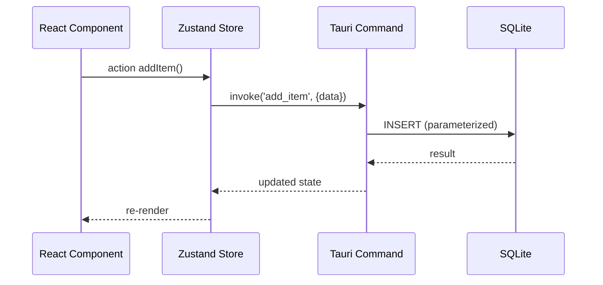
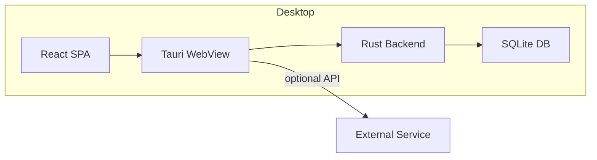

# Architecture — [Product Name]

> **Status**: Draft
> **Last Updated**: [Date]

---

## 1. System Overview

[Product Name] is a **local-first desktop application** that runs natively on macOS, Windows, and Linux. The frontend is a React + TypeScript + Vite SPA served inside a Tauri webview. Data persists locally in an encrypted SQLite database. There is no required network dependency for core functionality.

### Goals

- [e.g., Provide a fast, offline-first task timer]
- [e.g., Store all user data locally with optional encrypted backup]

### Non-Goals

- [e.g., Real-time collaboration across devices (v2)]
- [e.g., Cloud synchronization without explicit user opt-in]

---

## 2. Architecture Style

The application follows a **layered + component domain** architecture:

```
┌─────────────────────────────┐
│         UI Layer            │
│  React Components & Pages   │
└────────────┬────────────────┘
             │
┌────────────▼────────────────┐
│      State Layer            │
│  Zustand Stores (per domain)│
└────────────┬────────────────┘
             │
┌────────────▼────────────────┐
│     Service Layer           │
│  Business Logic / Services   │
└────────────┬────────────────┘
             │
┌────────────▼────────────────┐
│    Native Layer (Tauri)      │
│  Rust Commands & Plugins     │
└────────────┬────────────────┘
             │
┌────────────▼────────────────┐
│     Storage Layer            │
│   SQLite Database            │
└─────────────────────────────┘
```

---

## 3. Major Components

| Component | Responsibility | Key Files |
|-----------|----------------|-----------|
| **App Shell** | Layout, theme provider, global error boundary | `src/App.tsx`, `src/main.tsx` |
| **Router** | Page routing | `src/App.tsx` (or `src/routes/`) |
| **[Domain] Feature** | [Domain-specific widgets & pages] | `src/features/[domain]/` |
| **Timer Engine** | Countdown, phase transitions, scheduling | `src/features/timer/` |
| **DB Layer** | SQLite access via Tauri commands | `src/lib/db/` |
| **Stores** | State management per domain | `src/features/*/use-*-store.ts` |
| **UI Primitives** | Reusable buttons, inputs, dialogs | `src/components/ui/` |
| **Tauri Bridge** | Rust command definitions & handlers | `src-tauri/src/commands/` |

---

## 4. Data Flow

### Read Path



### Write Path



---

## 5. Authentication & Authorization

| Aspect | Decision |
|--------|----------|
| **Auth** | [e.g., No auth; device-local. Optional passphrase for backup encryption.] |
| **Authorization** | [e.g., All data belongs to single local user; no multi-user RBAC.] |
| **Multi-user** | [e.g., Not supported in v1.] |

---

## 6. External Services

| Service | Purpose | Required? | Notes |
|---------|---------|-----------|-------|
| [e.g., Prayer Times API] | [Fetches prayer times for location] | Optional | [Cached locally; falls back to calculation] |
| [None / Add as needed] | | | |

---

## 7. Background Jobs

[Describe how background/periodic tasks are handled. E.g., Tauri background tasks, interval timers, or scheduled commands.]

```
┌──────────────┐     ┌──────────────┐     ┌──────────────┐
│  Timer Tick  │───▶ │  Store Update │───▶ │  UI Re-render │
└──────────────┘     └──────────────┘     └──────────────┘
```

---

## 8. Caching Strategy

| Layer | Strategy | TTL |
|-------|----------|-----|
| **SQLite** | Source of truth | N/A |
| **Zustand Stores** | In-memory cache | Invalidated on write |
| **API Responses** | Local cache in DB | Configurable |

---

## 9. Storage

- **Primary**: SQLite database stored in the Tauri user data directory.
- **Schema**: See `DATA_MODEL.md`.
- **Migrations**: Managed via Tauri SQL plugin / custom migration runner.
- **Backup**: JSON export/import of all user tables.
- **Encryption**: [e.g., Database encryption at rest via SQLCipher if applicable.]

---

## 10. Deployment Architecture



| Artifact | Description |
|----------|-------------|
| **Production build** | `bun run tauri build` → produces `.appx`, `.msi`, `.dmg`, `.deb` |
| **Dev** | `bun run tauri dev` — hot reload + debugger |
| **Updater** | [e.g., Tauri updater configured to GitHub Releases] |

---

## 11. Important Architectural Decisions

| ADR ID | Decision | Rationale |
|--------|----------|-----------|
| [e.g., ADR-001] | [Local-first SQLite over cloud DB] | [Offline support, privacy] |

(See `04-ai/DECISIONS.md` for full records.)

---

## 12. Known Trade-offs

| Trade-off | Impact (Pro) | Impact (Con) |
|-----------|--------------|--------------|
| [SQLite only, no server DB] | [Offline, simple ops] | [No real-time sync] |
