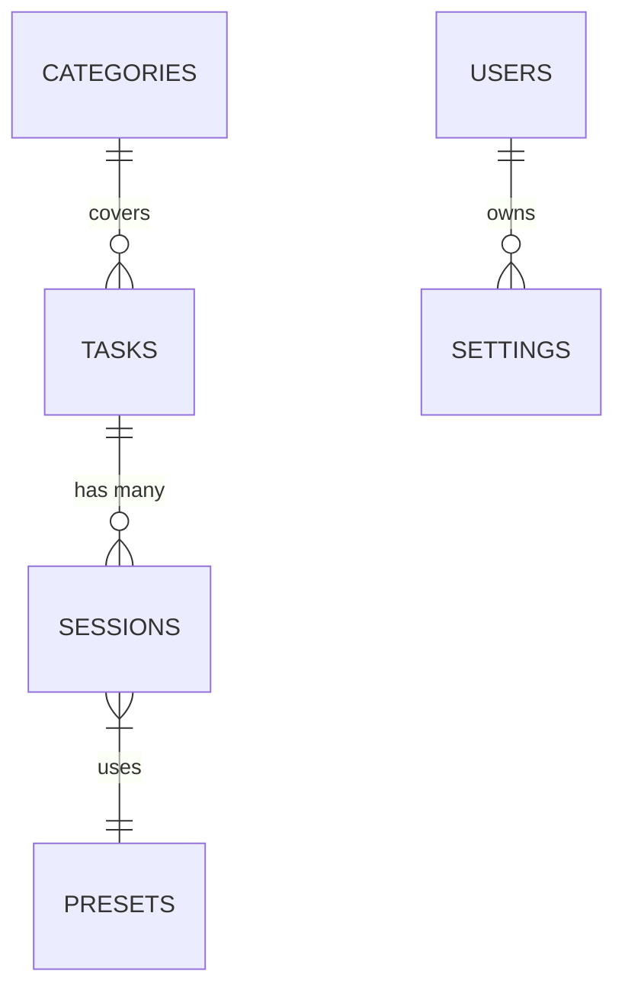
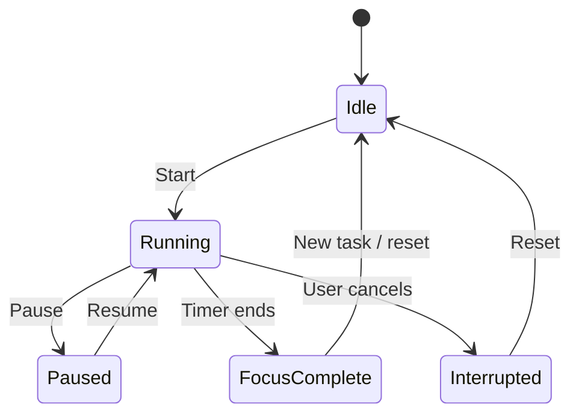
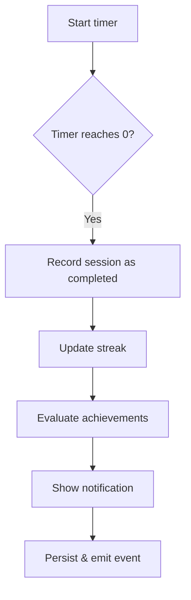

# Domain Model — [Product Name]

> **Status**: Draft
> **Last Updated**: [Date]

---

## 1. Core Entities

| Entity | Key | Description |
|--------|-----|-------------|
| [e.g., Task] | `id` (PK) | [A unit of work with a title, priority, category] |
| [e.g., Session] | `id` (PK) | [A Pomodoro-focused time block, 25 min by default] |
| [e.g., Category] | `id` (PK) | [Groups tasks for filtering/reporting] |
| [e.g., Setting] | `key` | [Key-value config stored in `settings` table] |

---

## 2. Entity Relationships

---

## 3. Domain Concepts

| Concept | Description | Rules |
|---------|-------------|-------|
| [e.g., Focus Session] | [A single timer run from start to completion] | [Must be >0 min; auto-completes on timer end] |
| [e.g., Streak] | [Consecutive days with ≥1 completed session] | [Breaks when a day has 0 completed sessions] |
| [e.g., Quality] | [User self-rating of focus quality post-session] | [Integer 1–5; no entry = unrated] |

---

## 4. Business Rules

### Confirmed Rules

| ID | Rule | Source |
|----|------|--------|
| BR-001 | [e.g., A session can only be started if no session is currently running] | [Product, PRD] |
| BR-002 | [e.g., Completed sessions cannot be modified] | [Product, PRD] |

### Assumptions (To Be Confirmed)

| ID | Assumption | Confidence |
|----|-----------|------------|
| BA-001 | [e.g., Overtime sessions count toward daily score] | [Low / Medium / High] |
| BA-002 | [e.g., Streak resets at local midnight, not 24h since last session] | [Medium] |

> Agents must verify assumptions before implementing. If uncertain, ask the user.

---

## 5. State Machines

### Session Lifecycle

---

## 6. Invariants

| Invariant | Enforcement |
|-----------|-------------|
| [e.g., Exactly one session is in `Running` state at a time per device] | Enforced in store before write |
| [e.g., `settings.key` is unique] | Enforced via DB unique constraint |

---

## 7. Workflows

### Workflow: Complete a Focus Session

---

## 8. Domain Events

| Event | Payload | Consumers |
|-------|---------|-----------|
| [e.g., `sessionStarted`] | `{sessionId, startedAt}` | [Timer, Analytics] |
| [e.g., `sessionCompleted`] | `{sessionId, quality, durationSec}` | [Streak, Score, Achievements] |

---

*If you are editing this file: confirm assumptions with stakeholders before treating them as facts.*
