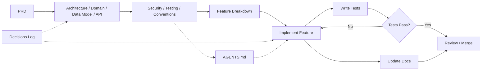

# AI Engineering Template

A reusable template repository for **local-first desktop applications** (React + TypeScript + Tauri) engineered for AI-assisted development. It provides living documentation, decision logs, architecture standards, and AI prompt templates so that AI agents and human engineers work from the same source of truth from day one.

---

## What This Is

This is a **project scaffold and documentation framework**, not a runnable application. Copy/clone it to bootstrap a new product, then fill in the placeholders (`[...]`) with product-specific details. Every file is intentionally generic so it can be reused across different local-first desktop apps.

## How To Use It

1. **Create a new repo** from this template (GitHub "Use this template" or clone + rename).
2. **Run the bootstrap prompt** (`prompts/01-bootstrap.md`) with your AI agent to analyze the existing codebase (or greenfield plan) and populate the initial docs.
3. **Design first** — complete `02-design/*` using `prompts/02-design.md` before writing any feature code.
4. **Break down features** — use `prompts/03-feature-breakdown.md` for each feature request.
5. **Implement** — follow `prompts/04-implement-feature.md` and the architecture & conventions docs.
6. **Iterate** — keep docs in sync with code. Every architectural or product decision is recorded in `04-ai/DECISIONS.md`.

## Directory Structure

```
01-product/        Product requirements & roadmap
02-design/         Architecture, domain, data model, API contracts
03-engineering/    Security, testing, coding conventions
04-ai/             AI workflow guides, decision logs
features/          Feature breakdown templates
prompts/           Reusable AI agent prompt templates
AGENTS.md          Living instructions for AI agents working on this project
.gitignore          Standard ignore for the target tech stack
```

## Workflow Overview



**Phase 1 — Bootstrap & Docs** (before code)
- Fill `AGENTS.md` with project-specific rules.
- Complete `01-product/PRD.md`.
- Complete `02-design/ARCHITECTURE.md`, `DOMAIN.md`, `DATA_MODEL.md`, `API.md`.
- Complete `03-engineering/SECURITY.md`, `TESTING.md`, `CONVENTIONS.md`.

**Phase 2 — Feature Delivery** (repeat per feature)
- Create a feature breakdown from `features/FEATURE_TEMPLATE.md`.
- Implement following architecture & conventions.
- Write tests; run the full validation suite.
- Update affected docs and decision log.

## Customization Guide

| Area | What to Customize |
|------|------------------|
| `AGENTS.md` | Language, naming, state-management, DB patterns |
| `CONVENTIONS.md` | Tech stack, linting, CI rules |
| `ARCHITECTURE.md` | Component boundaries, data flow |
| `DOMAIN.md` / `DATA_MODEL.md` | Actual entities and relationships |
| `TESTING.md` | Test runners, coverage thresholds |
| `prompts/*` | Brand/product-specific prompt wording |
| `.gitignore` | Adjust for your build tools |

Replace every `[...]` placeholder before starting development.

## Tech Stack Assumptions

This template targets a **local-first desktop app**:

- **Frontend**: React + TypeScript + Vite
- **Backend**: Tauri (Rust)
- **Storage**: SQLite (via Tauri plugin)
- **Styling**: CSS with design tokens
- **State Management**: Zustand (per-domain stores)
- **Testing**: Vitest (unit), Playwright (E2E)
- **Package Manager**: Bun (or npm/yarn — adjust as needed)

Adjust `CONVENTIONS.md` and `.gitignore` if you use a different stack.
